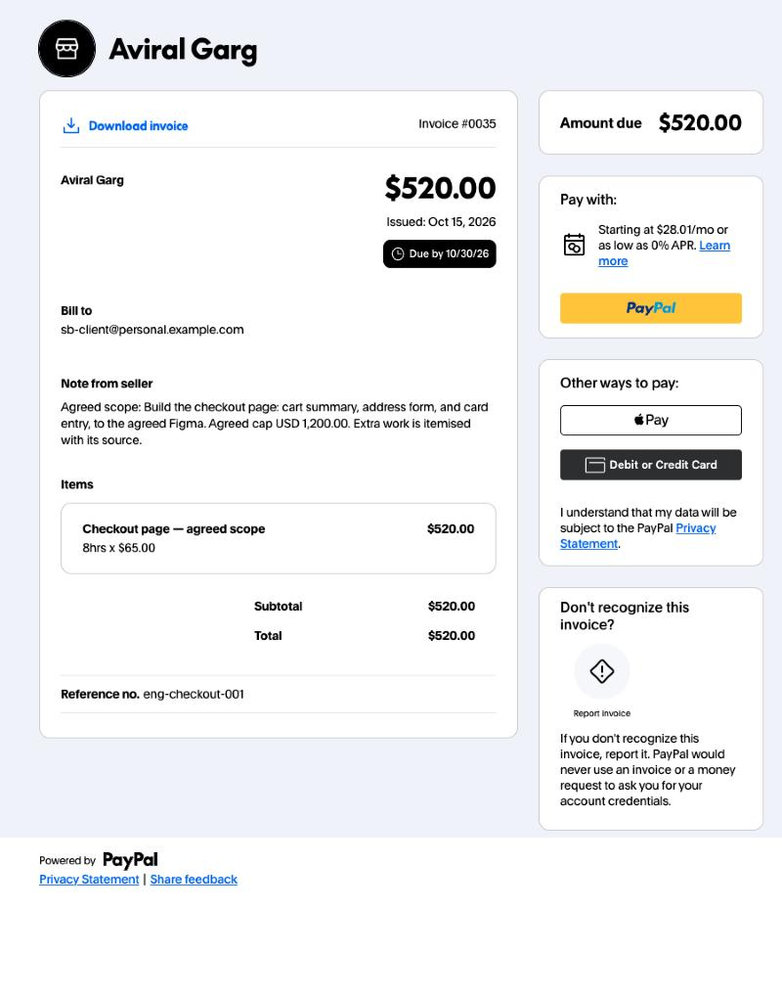
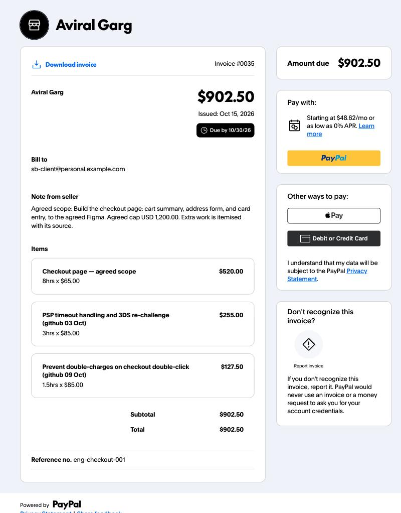
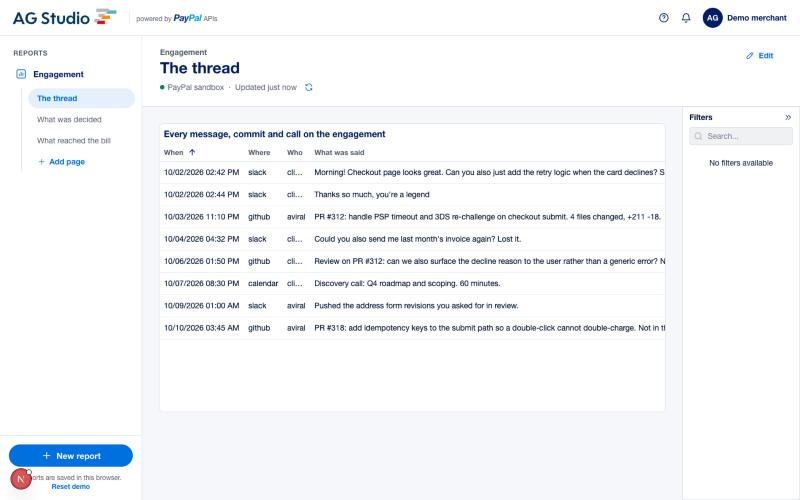
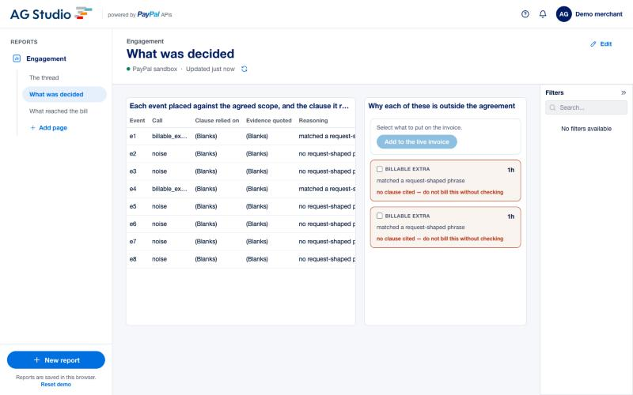
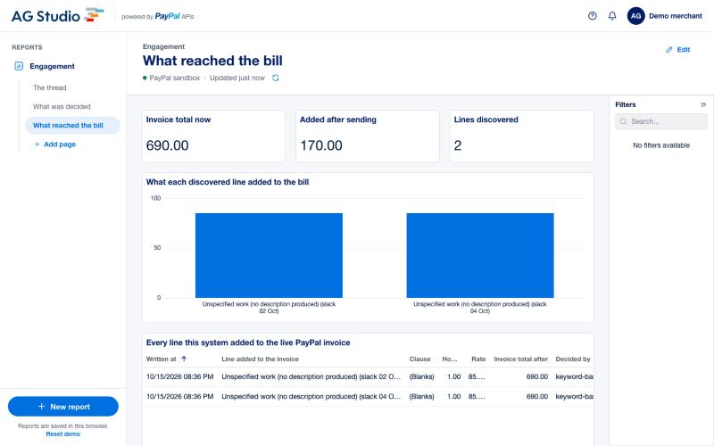

# unlogged

[](https://github.com/aviralgarg05/unlogged/actions/workflows/ci.yml)
[](LICENSE)

**The work you never wrote down is the work you never got paid for.**

<table>
<tr>
<td width="50%"></td>
<td width="50%"></td>
</tr>
<tr>
<td><em>The invoice the client has had since day one. $520.00.</em></td>
<td><em>The same invoice. Same id, same link, same QR. Two pieces of
discovered work itemised onto it, each naming where it came from, and
PayPal emailed the client that it changed.</em></td>
</tr>
</table>

You agree a scope. Then the work arrives anyway — in a Slack thread, a PR review, a call
that overran. Some of it is inside what you agreed and some of it isn't, and the part that
isn't mostly never reaches the invoice, because writing it down at the time is the one
thing nobody does.

`unlogged` watches the real work surface, decides which side of the agreed line each piece
falls on, and **itemises the billable extras onto an invoice the client already has** —
same invoice id, same link they filed on day one, each line naming where the work came
from, rendered by PayPal on PayPal's own page.

---

## For judges (2 minutes)

```bash
git clone https://github.com/aviralgarg05/unlogged && cd unlogged
uv sync --extra dev
uv run scripts/verify.py               # checks every claim in this README
```

That script is the short version of everything below: it runs the tests, reproduces the
evaluation to the cent, replays the full apply flow from recorded PayPal exchanges, and checks
the submission requirements (LICENSE present, no key tracked, no key anywhere in the repo).
13 checks keyless, 19 with sandbox credentials, about twenty seconds.

With sandbox credentials, `uv run scripts/verify.py --live` also re-proves the central claim
against PayPal on the day you run it — it creates a real invoice, grows it, and prints the
payer URL so you can open it yourself. A date in a README is worth less than a command.

Or run the pieces directly:

```bash
uv run pytest -q                       # 72 tests, no credentials needed
uv run unlogged discover \
  --engagement fixtures/engagement.json \
  --events fixtures/events.jsonl \
  --invoice-id INV2-DEMO
```

No PayPal account, no OpenAI key, no licence key. Recorded PayPal exchanges replay from
`cassettes/`, and the model's own verdicts replay from the same directory as `verdict-*.json` — so the arm the
README argues for is the arm you see, with no key. Blank the key *and* delete the recordings and
it falls back to the keyword baseline, which is not a stub but **the evaluation's ablation arm**,
the thing the model has to beat.

Both arms are scored, and both run with no key:

| arm | accuracy | precision | recall | overbilled | missed | uncited | $ overbilled | $ missed | hours wrong | $ hour error |
|---|---|---|---|---|---|---|---|---|---|---|
| keyword-baseline | 12% | 0% | 0% | 2 | 2 | 0 | $170.00 | $425.00 | 0 | $0.00 |
| **gpt-6.1-sol** | **100%** | **100%** | **100%** | **0** | **0** | **0** | **$0.00** | **$0.00** | **1** | **-$42.50** |

The last two columns exist because the model does not get a clean sheet. It calls all eight
events correctly and cites a clause for each, then estimates `e8` at 1.5 hours where the label
says 2.0 — $42.50 of real work the client is never asked to pay for. Scoring used to return as
soon as the predicted class matched the label, so that error was invisible and this table read
as perfect. It is reported in the client's favour, which is the safer direction to be wrong in,
and it is still wrong.

The baseline bills a request for *a copy of last month's invoice*, bills the ask rather than
the work that answered it, and misses both pieces of real out-of-scope engineering — including
a PR whose own description says "not in the original scope". The model gets all eight right and
cites a clause and a quoted span for every one.

**Eight events is a smoke test, not a benchmark**, and
[`docs/HONESTY.md`](docs/HONESTY.md) says so plainly along with what would make it a result.
The verdicts are recorded under `cassettes/`, so this table reproduces with no OpenAI account —
which is also why running it costs nobody anything.

### Running it with your own keys

Nothing below is required to evaluate the project — the commands above work with none of it.
Both files are gitignored; no key is ever committed, and none appears in the git history.

**The Python service** reads `.env` (copy `.env.example`):

| Variable | What it does |
|---|---|
| `OPENAI_API_KEY` | Switches the adjudicator from the keyword baseline to `gpt-6.1-sol`. The CLI, `/health` and the dashboard all follow automatically; there is no other change to make. |
| `PAYPAL_CLIENT_ID` / `PAYPAL_CLIENT_SECRET` | A sandbox REST app from developer.paypal.com. |
| `UNLOGGED_REPLAY` | `1` replays recorded responses (default), `0` calls the live sandbox. |

**The dashboard** reads `web/.env.local`:

| Variable | What it does |
|---|---|
| `AG_STUDIO_OPENAI_API_KEY` | Enables the AG Studio assistant. Read server-side only — there is deliberately no `NEXT_PUBLIC_` variable for it, so it is never inlined into the browser bundle. Falls back to `OPENAI_API_KEY`. |
| `OPENAI_MODELS` | Comma-separated. Two or more turns on the model picker in the chat panel. |
| `UNLOGGED_API` | Where the Python service is listening. Defaults to `http://127.0.0.1:8000`. |

With a key set, confirm it took effect:

```bash
curl -s localhost:8000/health    # "adjudicator" flips to gpt-6.1-sol
```

### The dashboard

One command, both halves, still no credentials:

```bash
docker compose up        # dashboard on :3000/dashboard, API on :8000
```

Or without Docker:

```bash
uv run uvicorn unlogged.web:app --port 8000            # one shell
cd web && npm install && npm run build && npm start    # another
```

Built on PayPal's own [AG Studio boilerplate](https://github.com/paypaldev/hackathon-paypal-ag-grid-boilerplate),
with one deliberate departure. The boilerplate hands AG Studio a fully-materialised array and
lets the engine filter, sort and page it in the browser. `app/dashboard/studio/data.ts` instead
declares `capabilities: { pagination, filter, sort }`, so the engine sends `paging`, the applied
filter tree and the sort order down to `getData`, trusts the returned window as-is, and never
re-filters locally. **The rows stay in the Python service.**

Four more things the surveyed entries leave untouched. A sixth agent owns the decision this
product exists to make and hands layout work to AG's built-in five through `delegateTo`.
`defaultToolCalls` seeds it with the scope, the adjudications and the changes already made
*before its first turn*, so its opening reply is a decision rather than a question. The one
tool that moves money is `kind: 'server'` — Studio advertises the schema and never runs it, so
the PayPal write happens in our own route and the credential never enters the bundle. And an
`AgAiTelemetryObserver` reads `api.getState()` synchronously in-loop, where it sees the exact
post-mutation state a call produced, then batches to the backend for scoring.

No AG Studio licence key. `validateLicense()` only ever sets a watermark message — no branch
disables a feature — and `isDisplayWatermark()` returns false on localhost. A trial key is
strictly worse than none, because a trial can expire and nothing here can.

---

<table>
<tr>
<td width="33%"></td>
<td width="33%"></td>
<td width="33%"></td>
</tr>
<tr>
<td><em>The thread, paged from the server.</em></td>
<td><em>Each event against the agreed scope. The baseline's two billings are
drawn as defects because neither cites a clause.</em></td>
<td><em>What reached the bill, and the one button that puts it there.</em></td>
</tr>
</table>

## How this is judged, and where to check each claim

Five equally weighted criteria. For each one, a command that runs with **no credentials**, and
the file that implements it — so nothing has to be taken on trust.

| Criterion | Run this | Implemented in |
|---|---|---|
| **Technological Implementation** | `uv run scripts/verify.py` — 13 checks including the full PayPal apply flow, replayed from recorded exchanges | [`paypal/invoices.py`](src/unlogged/paypal/invoices.py), [`docs/UPSTREAM.md`](docs/UPSTREAM.md) |
| **Design** | `docker compose up` → `/dashboard` — rows fetched a page at a time and never materialised in the browser, a custom widget, and the one button that moves money | [`studio/data.ts`](web/app/dashboard/studio/data.ts), [`evidence-card.tsx`](web/app/dashboard/studio/widgets/evidence-card.tsx) |
| **Potential Impact** | `uv run unlogged evaluate …` — the naive pass leaves $425 of real work off the bill and bills $170 it should not | [`eval/harness.py`](src/unlogged/eval/harness.py), [`fixtures/gold.jsonl`](fixtures/gold.jsonl) |
| **Innovation** | The same invoice id and QR at $520.00 and at $902.50, in the two images above | [`Invoices.add_items`](src/unlogged/paypal/invoices.py) |
| **Presentation** | [`docs/VIDEO.md`](docs/VIDEO.md) — the shot list, and the rule that every claim lands on PayPal's own page | — |

**Read [`docs/HONESTY.md`](docs/HONESTY.md) before the rest.** It says what is verified, what is
simulated, and what is not yet true — including that eight events is a smoke test rather than a
benchmark, and that the fixture engagement was written for this repo.

Four findings are filed upstream rather than kept as talking points, in
[`docs/UPSTREAM.md`](docs/UPSTREAM.md): PayPal's documented discount path is accepted and not
stored, `generate-qr-code` returns a base64 multipart envelope rather than an image, the generated
Server SDK ships no Invoicing controller, and a public AG Studio custom widget cannot declare
`formatShape` at all. Each one is reproducible from this repo.

## Status

| | |
|---|---|
| Mechanism verified live | ✅ 2026-10-15, `$520 → $902.50`, reproducible from `cassettes/` |
| Invoice engine | ✅ live sandbox, end to end |
| Webhooks + signature verification | ✅ |
| HTTP API + `/health` | ✅ |
| Keyword baseline (the ablation arm) | ✅ scores 0% precision, 0% recall |
| Evaluation harness + JUnit | ✅ |
| AG Studio dashboard | ✅ async data source, server-side paging |
| Keyless replay path | ✅ full flow runs with no credentials |
| AI harness: custom agent, server tool, telemetry | ✅ built |
| APIMatic SDK: settlement breakdown | ✅ `payments.get_captured_payment` |
| Docker Compose, Render blueprint | ✅ API image built and verified |
| Tests | ✅ 72 Python (incl. a property test on the money path), 4 TypeScript |
| Model adjudication | ✅ `gpt-6.1-sol`, 8/8 calls on the fixture, one hour estimate short, recorded so it replays keyless |
| Evaluation against a real past engagement | ⏳ needs a real thread — see [HONESTY.md](docs/HONESTY.md) |

## The mechanism

An invoice that has already been sent can **grow line items**. The invoice id, and therefore
the payer-view URL and the QR the client filed, stay valid.

Verified live against the PayPal sandbox on 2026-10-15, once per arm, on two real invoices.
Both runs are recorded, so both replay to the cent with no credentials.

The **keyword baseline** — keyword triage over the thread, which is what people fall back on
today — reaches `$520.00 → $690.00` and puts this in front of the client:

```
Checkout page — agreed scope                              $520.00   8hrs x $65.00
Unspecified work (no description produced) (slack 02 Oct) $ 85.00   1hr  x $85.00
Unspecified work (no description produced) (slack 04 Oct) $ 85.00   1hr  x $85.00
                                                Subtotal  $690.00
                                                   Total  $690.00
```

It is wrong in four visible ways: it bills a request rather than the work that answered it, it
bills a plea for a copy of an old invoice, it cannot describe either of them, and it misses both
pieces of real out-of-scope engineering. A client reading that line has nothing to agree or
object to.

The **model arm** reaches `$520.00 → $902.50` on the same events and the same rate card:

```
Checkout page — agreed scope                              $520.00   8hrs   x $65.00
PSP timeout handling and 3DS re-challenge (github 03 Oct) $255.00   3hrs   x $85.00
Prevent double-charges on checkout double-click (github 09 Oct) $127.50   1.5hrs x $85.00
                                                Subtotal  $902.50
                                                   Total  $902.50
```

Each line names the work, cites the clause that put it outside scope, and carries where it came
from. `fixtures/gold.jsonl` labels the two billable extras `e3` (3hrs, the PSP-timeout PR) and
`e8` (2hrs, the idempotency PR), so a fully correct run reaches **$945.00**. The model finds both
and prices the second at 1.5hrs rather than 2.0 — **$42.50 of real work the client is never
billed for**. That gap is in the table above and in the eval report; it is not rounded away.

The mechanism itself — that a sent invoice grows line items while its id, payer URL and QR stay
valid — holds in both runs and is reproducible from the committed cassettes:

```
$520.00 → $902.50   invoice id unchanged   QR unchanged
```

```bash
uv run unlogged discover --engagement fixtures/engagement.json \
  --events fixtures/events.jsonl --invoice-id $(cat fixtures/demo-invoice-id) --apply
```

The client is notified by PayPal itself on every change — `send_to_recipient=true` on the
update is PayPal's own machinery, not something invented here. The agreed scope and cap are
written into `detail.note`, which PayPal renders to the payer as "Note from seller".

**Three things this cost a day to find out.** They are written down in `docs/VERIFIED.md`
with the raw exchanges, because the published docs do not say any of them:

1. `PUT /v2/invoicing/invoices/{id}` is a **full-document replace**. Echo back the
   `amount.value` you just read and you get `400 calculation_error`. Send the currency and
   the breakdown and let PayPal do the arithmetic.
2. `generate-qr-code` returns **`multipart/form-data`**, not `image/png`. The PNG is base64
   text in a part named `image` whose own Content-Type is `text/plain`.
3. Exactly **three** top-level invoice properties are readOnly — `id`, `parent_id`, `links`.
   `status`, `due_amount` and `gratuity` are not, contrary to folklore.

**And one upstream defect.** PayPal's documented discount path,
`detail.payment_term.conditional_rules.early_payment_discount`, is accepted with HTTP 201
and then **silently dropped** — tested with `DUE_ON_RECEIPT`, `NET_30` and
`DUE_ON_DATE_SPECIFIED`, with discount dates both today and future.
`POST /conditional-rules` returns **HTTP 500**, because the only non-`links` property of its
request schema is `readOnly`. The official agent toolkit's `PROMPTS.md` documents only that
dead path. Reproduction script and an upstream report are in `docs/`.

## Why the model is not optional

Deciding whether *"can you also just add the retry"* sits inside *"build the checkout page"*
is a judgement about two pieces of prose, against a rate card that is itself prose. There is
no column to join on. Being asked politely does not make something billable, and arriving
with no request at all does not make it unbillable — which is precisely where keyword
triage, the thing people actually fall back on today, breaks.

Every verdict must quote the clause it relied on and the span of the event that decided it.
A verdict that cannot cite its own evidence is not auditable, and this bills a real person.

## Why PayPal

The user is a contractor in India, Pakistan, Nigeria, Brazil or Poland billing a client in
the US, UK or EU. Inbound cross-border is exactly what PayPal does here, and PayPal hosts the
payer page, the itemisation and the QR, so the contractor ships none of it.

It also answers the obvious question directly: a static UPI QR is payee-only and the **payer**
types any amount — no itemisation, no agreed ceiling, no record of what was agreed, and no
cross-border reach. This is the inverse.

## APIMatic, and the division of labour it forced

The APIMatic-generated [`paypal-server-sdk`](https://pypi.org/project/paypal-server-sdk/) ships
six controllers — oauth, orders, payments, subscriptions, transaction search, vault — and **none
of them is Invoicing**. Everything this product does to an invoice therefore goes through
`paypal/invoices.py` on `httpx`, because there is no alternative.

The SDK is used for the one part it genuinely serves, and it closes the loop the product opens.
A contractor's question does not end at *did the client pay*; for cross-border work it ends at
*how much reached me*, and the difference is PayPal's cross-border and conversion cut.
`payments.get_captured_payment` returns `seller_receivable_breakdown` — gross, fee, net, and the
exchange rate PayPal used — which is PayPal stating its own arithmetic rather than us estimating it.

The missing controller is reported in [`docs/UPSTREAM.md`](docs/UPSTREAM.md) rather than worked
around quietly, because the Context Plugin's premise is that an agent gets a grounded answer about
what the SDK can do — and for anything invoicing-shaped, the grounded answer is that it cannot.

## Layout

```
src/unlogged/
  config.py              settings; replay is the default so it runs with no credentials
  paypal/client.py       OAuth2, PayPal-Request-Id, cassette replay
  paypal/invoices.py     create, silent send, grow items, QR, payer URL
  scope/models.py        Engagement, ScopeClause, WorkEvent, Verdict
  scope/baseline.py      keyword triage — the ablation arm
  scope/adjudicate.py    gpt-6.1-sol on the Responses API, strict JSON schema
  ledger.py              append-only record of every change to a live invoice
  cli.py                 open-engagement / discover / show
```

## Licence

MIT — see [LICENSE](LICENSE).
